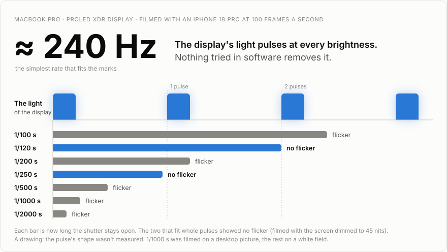
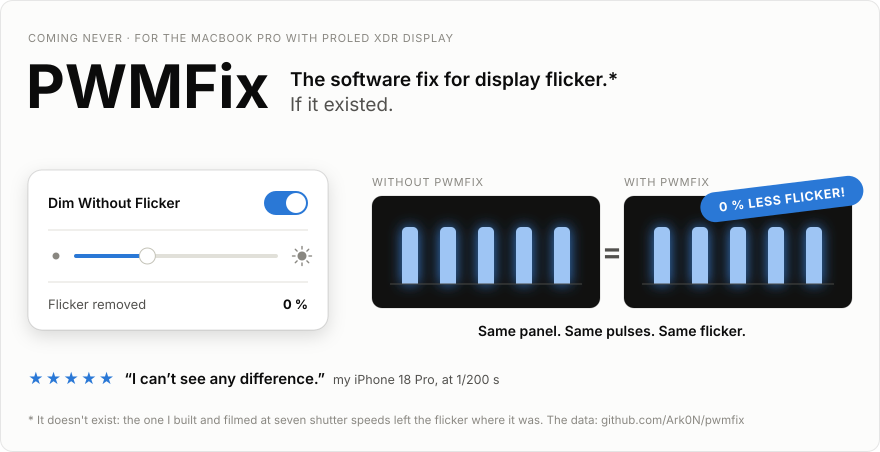
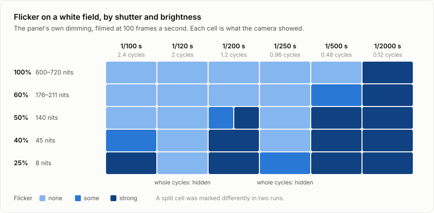
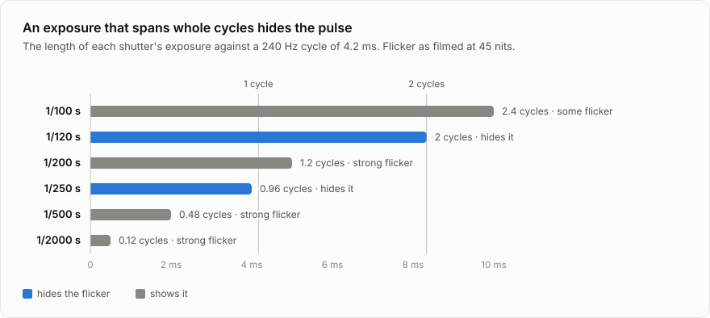
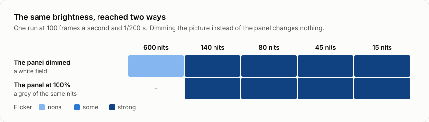
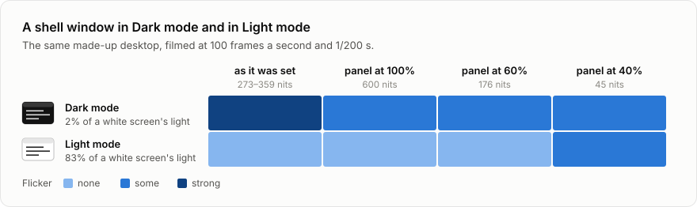

# PWMFix: the MacBook Pro display's flicker, tested

<picture>
  <source media="(prefers-color-scheme: dark)" srcset="docs/figures/hero-dark.svg">
  
</picture>

<picture>
  <source media="(prefers-color-scheme: dark)" srcset="docs/figures/funny-dark.svg">
  
</picture>

Can software dim the MacBook Pro's display (PROLED XDR) without the flicker of its own dimming?
**No.** This is the record of one day of filming the screen to find out: what the camera showed,
what was tried, and the data.

- **The display pulses at every brightness**, plain white at 100% included, **at about 240 Hz** by
  the simplest reading of the marks.
- **The dimmer the picture, the stronger the flicker** on camera.
- **Nothing in software removed it.** Dimming the picture instead of the panel gives the same
  flicker at the same brightness.
- **A brighter picture showed less of it**: at 1/200 s, Light mode was clean where Dark mode
  flickered. At 1/1000 s both flickered.
- **Whether it matters to the eye isn't known.** Everything here is what a camera shows.

I hope someone can prove me wrong about this data. And maybe there is a fix for this! I am open to inputs.
I think scientifically.

**All results:** [the full review](docs/review.md) · [every mark, as CSV](docs/marks.csv) ·
[the working notes](docs/findings.md)

## The display pulses at about 240 Hz

A plain white field, dimmed with the brightness slider and filmed with an iPhone 18 Pro at 100
frames a second and six shutter speeds. The owner marked each step by what the camera showed: no, some or strong flicker.

<picture>
  <source media="(prefers-color-scheme: dark)" srcset="docs/figures/shutters-dark.svg">
  
</picture>

The same as a table

| Panel | 1/100 s | 1/120 s | 1/200 s | 1/250 s | 1/500 s | 1/2000 s |
| --- | --- | --- | --- | --- | --- | --- |
| 100% (600–720 nits) | none | none | none | none | none | strong |
| 60% (176–211 nits) | none | none | none | none | some | strong |
| 50% (140 nits) | none | none | some, strong | none | strong | strong |
| 40% (45 nits) | some | none | strong | none | strong | strong |
| 25% (8 nits) | strong | none | strong | some | strong | strong |

Two things stand out. At 1/2000 s everything flickers, white at full brightness too, so **the panel
pulses at every brightness**; a brightness "where the flicker starts" belongs to the camera's
shutter, not to the panel. And two shutters hide it almost completely, at any brightness.

<picture>
  <source media="(prefers-color-scheme: dark)" srcset="docs/figures/cycles-dark.svg">
  
</picture>

An exposure that spans a whole number of cycles collects the same light wherever it starts, so the
pulse disappears from the picture. The two shutters that hide it are the two that fit 240 Hz:
1/250 s is just short of one cycle and 1/120 s is two. The idea came from a run of grey fields
that happened to be filmed at 1/250 s and came out clean. It then said in advance what two more
runs would show, a dimmed white field clean at 1/250 s and at 1/120 s, and both did.

- **It isn't a slow shutter that hides it.** 1/100 s is slower than 1/120 s and shows strong
  flicker at 8 nits, where 1/120 s shows none.
- **It isn't 480 Hz.** 1/500 s would then span a cycle, and it's among the strongest.
- **It isn't 120 Hz.** 1/250 s would then be half a cycle and couldn't hide it.
- **It could be 720 Hz.** Any multiple of 240 Hz fits the same two shutters, and these marks
  don't rule that one out. 240 Hz is the simplest rate that fits.

240 Hz is two pulses for each of the screen's 120 frames a second. It's an inference from which
shutters hide the flicker, not a measurement with an instrument. The marks pin the rate at 140
nits and below; above that the pulse showed only at the fastest shutters, which can't tell its
rate.

## Dimming the picture instead of the panel doesn't help

The idea this started with: hold the panel at 100%, where it looks steady, and make the picture
darker instead. The test shows each brightness twice in one run, first with the panel
dimmed, then with the panel at 100% showing a grey of the same nits.

<picture>
  <source media="(prefers-color-scheme: dark)" srcset="docs/figures/compare-dark.svg">
  
</picture>

At the same brightness, a dark picture on a bright panel flickers like the panel's own dimming.
All eight were marked "strong", so a difference of degree wouldn't show.

Everything else that was tried, at 100 frames a second and 1/200 s:

| Tried | Result |
| --- | --- |
| The display's gamma table | Looked like a fix at first, and wasn't (below) |
| Fewer, brighter pixels: dot patterns with 1 of 2 to 1 of 16 lit | Still flickered once the average was below about 160 nits |
| The driver's pulse width switch (by its name, iPhone's Display Pulse Smoothing) | The driver takes it; nothing changes |
| Dithering off | No change |
| 60, 50 and 48 Hz refresh | No change; 50 Hz only puts a 100 fps camera in step |
| The display's presets | "nothing changed" (the camera's setting wasn't recorded) |

## Dark mode shows it more than Light mode

A made-up desktop with a shell window, the same picture in both modes, at four brightness levels.

<picture>
  <source media="(prefers-color-scheme: dark)" srcset="docs/figures/modes-dark.svg">
  
</picture>

The same as a table

| Panel | Dark mode | Light mode |
| --- | --- | --- |
| as it was set (359 nits in Dark, 273 in Light) | strong | none |
| 100% (600 nits) | some | none |
| 60% (176 nits) | some | none |
| 40% (45 nits) | some | some |

That's at 1/200 s. The Dark version gives about 2% of the light a white screen would, and it
flickers at every brightness, also with the panel at 100%. The Light version is clean down to the
panel at 60%. What counts is how much light the picture gives, however the brightness is set. At
1/1000 s both modes were strong at every level, so the Light version pulses too; the slower
shutter shows less of it.

## How the first reading went wrong

For the first two hours of testing the conclusion was the opposite, and an app was built on it
(it didn't work, and it isn't in this repo).

1. **Every mark was at one shutter.** At 1/200 s a white field is clean above about 170 nits, which
   looked like a threshold of the panel. It's a threshold of the shutter.
2. **The dimmed pictures were brighter than their labels.** They were dimmed with the gamma table
   on an assumed curve, never compared by eye, and were clean on camera because they were brighter.
3. **The owner caught it**: "when you show 'with pwm fix' the screen gets super bright".
4. **Tested at truly equal brightness**, the dimmed picture flickered like everything else.

[The review](docs/review.md#5-how-the-first-reading-went-wrong) has the full account.

## What it means

- **For a software fix:** there isn't one among the things tried. The pulse is in how the panel
  makes its light.
- **For reducing it:** maybe a brighter picture. Light mode with the panel at 60% or more was the
  mildest setting found, by a camera at 1/200 s; at 1/1000 s it flickered like the rest.
- **For filming this screen:** 1/120 s gave a steady picture at every brightness tested, and
  1/250 s nearly (a little flicker at 8 nits).
- **For the eye:** unknown. A camera isn't an eye.

Not tested: frame rates other than 100 a second, the shutters 1/50, 1/60, 1/240 and 1/400 s, other
machines, HDR content, external displays, and the light itself (no light meter, no oscilloscope).
The camera's exposure wasn't recorded either (ISO, aperture, whether a bright field was
overexposed), and an overexposed picture would hide flicker.

## All results

| What | Where |
| --- | --- |
| The full review: setup, every test, the reasoning, the limits | [`docs/review.md`](docs/review.md) |
| All 113 marks, each with the camera's setting and what was on the screen | [`docs/marks.csv`](docs/marks.csv) |
| The working notes, in the order things were found | [`docs/findings.md`](docs/findings.md) |
| The figures above, and the script that draws them from the marks | [`docs/figures`](docs/figures), [`scripts/make-figures.py`](scripts/make-figures.py) |

One MacBook Pro (Mac17,13, macOS 27.2.1), one camera (an iPhone 18 Pro), one day: 2026-11-12.

The text, the data and the figures are under the [MIT License](LICENSE).
